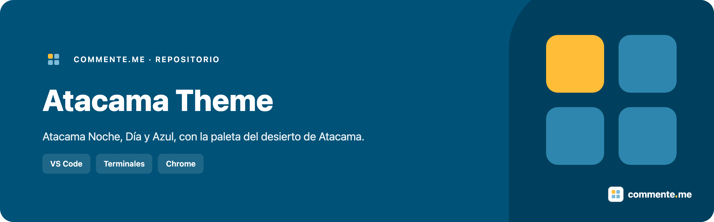

# Atacama Theme

**Tema oscuro y claro con la paleta del desierto de Atacama: azul profundo y amarillo de acento.**

Versión 1.0.1 · estable. Cambios en [vscode/CHANGELOG.md](./vscode/CHANGELOG.md).

## Instalación

```bash
code --install-extension commenteme.atacama-theme
```

Funciona en VS Code, Cursor, Windsurf y VSCodium.

## Uso

`Cmd/Ctrl + K`, `Cmd/Ctrl + T` y elige **Atacama Noche** o **Atacama Día**. Íconos y uso completo en [`vscode/`](./vscode).

### Que incluye

| Sabor | Fondo | Acento | Uso |
|---|---|---|---|
| **Atacama Noche** | `#0F1F29` | `#FFBD38` | Editor y terminal, oscuro |
| **Atacama Día** | `#FFFFFF` | `#005278` | Editor y terminal, claro |
| **Atacama Azul** | `#00405E` | `#FFBD38` | Solo terminal y chat |

| App | Carpeta | Estado |
|---|---|---|
| VS Code · Cursor · Windsurf · VSCodium | [`vscode/`](./vscode) | Listo |
| Zed · Neovim | Todavía no | Próximamente |
| Warp | [`warp/`](./warp) | Listo |
| Ghostty | [`ghostty/`](./ghostty) | Listo |
| iTerm2 | [`iterm2/`](./iterm2) | Listo |
| Windows Terminal | [`windows-terminal/`](./windows-terminal) | Listo |
| Alacritty | [`alacritty/`](./alacritty) | Listo |
| Kitty | [`kitty/`](./kitty) | Listo |
| Chrome · Edge · Brave · Arc | [`chrome/`](./chrome) | Listo |
| Slack | Todavía no | Próximamente |
| JetBrains · Obsidian · Raycast · Firefox | Todavía no | Próximamente |

### Por que existe

Nació en el equipo que construye tiendas en VTEX IO, Shopify y Adobe Commerce, y es público, sin costo. Los colores viven en un solo archivo, [`palette.json`](./palette.json): cada port sale de ahí, nunca de un hex copiado a mano.

## Desarrollo

Los colores viven solo en [`palette.json`](./palette.json). `node terminais.mjs` genera los temas de Ghostty, iTerm2, Windows Terminal, Alacritty y Kitty en los tres sabores, y `node terminais.mjs --check` falla si algún archivo no coincide con la paleta. Warp tiene su propio generador, `warp/build.mjs`.

Conventional Commits; rama saliendo de `dev` y PR contra `dev`.

### Sumar un port

1. Abre un issue con el nombre de la app.
2. Usa solo los colores de `palette.json`.
3. Suma una captura con Noche y otra con Día.

Desarrollo y publicación de la extensión: [`vscode/README.md`](./vscode/README.md#documentación).

## Estructura

```text
palette.json        # fuente única de los colores
terminais.mjs       # generador de los temas de terminal
vscode/             # extensión de VS Code, Cursor, Windsurf y VSCodium (README propio del Marketplace)
chrome/             # tema de Chrome, Edge, Brave y Arc
warp/               # tema de Warp y su generador
ghostty/  iterm2/  windows-terminal/  alacritty/  kitty/
```

## Licencia

[MIT](./LICENSE).

Contacto: hablecon@commente.me

---

_Hecho con amor y café por [zeluizr](https://github.com/zeluizr) y con la ayuda de [Claude](https://claude.ai/referral/Cz_UimA0NQ) ☕_
