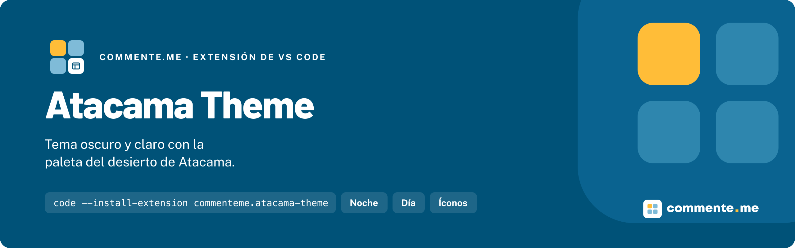

<p align="center">
  
</p>

# Atacama Theme

**Tema oscuro y claro con la paleta del desierto de Atacama: azul profundo, amarillo de acento, todo lo demás en silencio.**

[](https://marketplace.visualstudio.com/items?itemName=commenteme.atacama-theme)
[](https://marketplace.visualstudio.com/items?itemName=commenteme.atacama-theme)
[](./LICENSE)

## Instalación

VS Code, Cursor, Windsurf y VSCodium:

```bash
code --install-extension commenteme.atacama-theme
```

## Uso rápido

`Cmd/Ctrl + K`, `Cmd/Ctrl + T` y elige **Atacama Noche** o **Atacama Día**. Íconos y uso completo en [`vscode/`](./vscode).

## Que incluye

| Sabor | Fondo | Acento | Uso |
|---|---|---|---|
| **Atacama Noche** | `#0F1F29` | `#FFBD38` | Editor y terminal, oscuro |
| **Atacama Día** | `#FFFFFF` | `#005278` | Editor y terminal, claro |
| **Atacama Azul** | `#00405E` | `#FFBD38` | Solo terminal y chat |

| App | Carpeta | Estado |
|---|---|---|
| VS Code · Cursor · Windsurf · VSCodium | [`vscode/`](./vscode) | Listo |
| Zed · Neovim | — | Próximamente |
| Warp | [`warp/`](./warp) | Listo |
| Ghostty · iTerm2 · Windows Terminal · Alacritty · Kitty | — | Próximamente |
| Chrome · Edge · Brave · Arc · Slack | — | Próximamente |
| JetBrains · Obsidian · Raycast · Firefox | — | Próximamente |

## Por que existe

Nació en el equipo que construye tiendas en VTEX IO, Shopify y Adobe Commerce, y es público, sin costo. Los colores viven en un solo archivo, [`palette.json`](./palette.json): cada port sale de ahí, nunca de un hex copiado a mano.

## Documentación

### Sumar un port

1. Abre un issue con el nombre de la app.
2. Usa solo los colores de `palette.json`.
3. Suma una captura con Noche y otra con Día.

Desarrollo y publicación de la extensión: [`vscode/README.md`](./vscode/README.md#documentación).

## Contribuir · Licencia

Conventional Commits; rama saliendo de `dev` y PR contra `dev`. [MIT](./LICENSE)

---

Hecho por [commente.me](https://commente.me) · hablecon@commente.me
