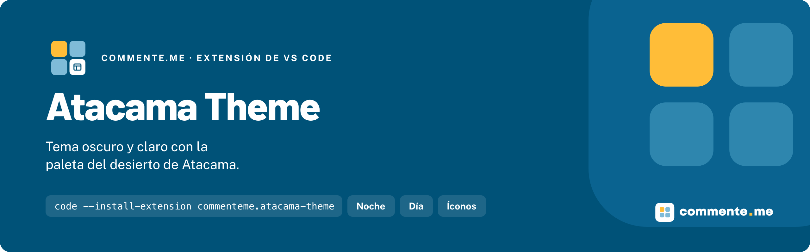

<p align="center">
  
</p>

# Atacama Theme

**Tema oscuro y claro para VS Code con la paleta del desierto de Atacama: azul profundo, amarillo de acento, todo lo demás en silencio.**

[](https://marketplace.visualstudio.com/items?itemName=commenteme.atacama-theme)
[](./LICENSE)

## Instalación

En Quick Open de VS Code (`Cmd/Ctrl + P`):

```
ext install commenteme.atacama-theme
```

Desde el terminal, `code --install-extension commenteme.atacama-theme`. En Cursor, Windsurf y VSCodium se instala desde Open VSX con el mismo nombre. Requiere VS Code `>= 1.70.0`.

## Uso rápido

`Cmd/Ctrl + K`, `Cmd/Ctrl + T` y elige **Atacama Noche** o **Atacama Día**. Para fijarlo en un repositorio, en `.vscode/settings.json`:

```json
{
  "workbench.colorTheme": "Atacama Noche",
  "workbench.iconTheme": "atacama-icons",
  "workbench.productIconTheme": "atacama-product-icons"
}
```

## Que incluye

Una extensión, tres tipos de tema:

| Tipo | Nombre | Como activarlo |
|---|---|---|
| Color Theme | Atacama Noche · Atacama Día | `Preferences: Color Theme` |
| File Icon Theme | Atacama Icons | `Preferences: File Icon Theme` |
| Product Icon Theme | Atacama Product Icons | `Preferences: Product Icon Theme` |

| Sabor | Fondo | Acento |
|---|---|---|
| Atacama Noche | `#0F1F29` | `#FFBD38` |
| Atacama Día | `#FFFFFF` | `#005278` |

La barra de estado va siempre en azul; el cursor y la pestaña activa, en amarillo (azul en Día). Las carpetas llevan un cuadrado de color en la esquina según el grupo: VTEX, Shopify, compartidas, IA (`.claude`, `skills`, `plugins`) y `.dante`.

### Sintaxis

| Rol | Noche | Día |
|---|---|---|
| Palabra clave | `#FFBD38` | `#005278` |
| String | `#E9D7AC` | `#8A5A00` |
| Propiedad / tag | `#7FBBD8` | `#1F6F96` |
| Función | `#B5E3C9` | `#1F7A5C` |
| Tipo / componente | `#F7A1B8` | `#B3123F` |
| Constante / número | `#C9B6FF` | `#6A4BC4` |
| Comentario | `#6F8692` | `#5C6D75` |

## Por que existe

Nació en el equipo que construye tiendas en VTEX IO, Shopify y Adobe Commerce, y es público, sin costo. La paleta vive en un solo archivo, `palette.json`, en la raíz del repositorio: cada port sale de ahí, y los de Zed, Neovim y los terminales vienen después.

## Documentación

### Desarrollo

```bash
git clone https://github.com/commentemeapp/atacama-theme.git
cd atacama-theme/vscode
npm install
npm run check         # valida los JSON y que cada color salga de palette.json o de los tokens
npm run build:icons   # genera la fuente de Atacama Product Icons
npm run package       # genera el .vsix
```

`F5` en VS Code abre una ventana de desarrollo con la extensión cargada. Para probar el `.vsix`: `code --install-extension atacama-theme-<versión>.vsix`.

### Publicar

La publicación es manual, siempre desde `main`:

```bash
npx vsce login commenteme
npm run publish:vsce      # VS Code Marketplace
npx ovsx create-namespace commenteme -p $OVSX_PAT   # solo la primera vez
npm run publish:ovsx      # Open VSX (Cursor, Windsurf, VSCodium)
```

## Contribuir · Licencia

Conventional Commits; rama saliendo de `dev` y PR contra `dev`. Para un color nuevo, cambia `palette.json` primero.

[MIT](./LICENSE)

---

Hecho por [commente.me](https://commente.me) · hablecon@commente.me
